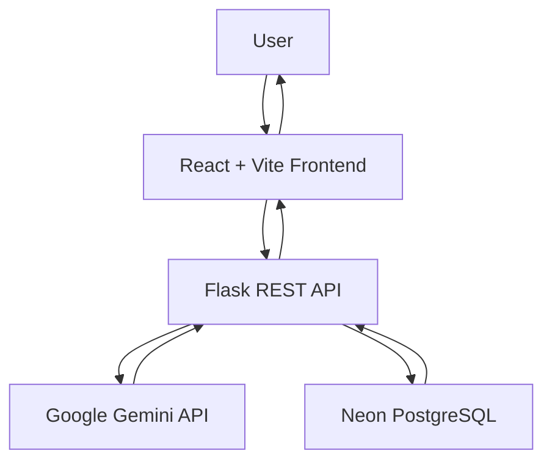

# 🚀 CodeBridge AI
### AI-Powered Career Guidance & Learning Platform

<p align="center">
  <a href="https://code-bridge-ai-alpha.vercel.app">🌐 Live Demo</a> •
  <a href="https://github.com/AR-Adhav/CodeBridge-AI">💻 GitHub Repository</a>
</p>

CodeBridge AI is an AI-powered career guidance platform designed to help students and fresh graduates identify skill gaps, understand industry expectations, and prepare for their desired careers.

By combining AI-powered skill analysis with personalized learning roadmaps, CodeBridge AI helps learners turn their career goals into actionable learning plans.

---

## ✨ Key Features

### 🤖 AI-Powered Skill Analysis
- Analyze existing technical skills.
- Identify missing skills for a target career role.
- Understand important hiring signals.
- Receive personalized portfolio project suggestions.

### 📚 Personalized Learning Roadmaps
- Generate learning plans based on existing skills and experience.
- Customize roadmaps according to career goals.
- Set study hours and learning duration.
- Receive weekly topics, practical tasks, mini-projects, and learning resources.

### 📈 Learning Progress Tracking
- Track completed and pending learning tasks.
- Save progress to the database.
- Continue learning after logging in again.

### 👤 User Authentication
- User registration and login.
- Email OTP verification.
- Personalized user profiles.
- Session-based authentication.

### 💼 Career Opportunities
- Explore job and internship opportunities.
- Access career-related information.
- Support recruiter verification workflows.

---

## 🛠️ Technology Stack

| Component | Technologies |
|---|---|
| Frontend | React.js, Vite, CSS |
| Backend | Python, Flask |
| AI Integration | Google Gemini API |
| Database | Neon PostgreSQL |
| Database Driver | Psycopg |
| Deployment | Vercel, Render |
| Version Control | Git, GitHub |

---

## 🏗️ System Architecture



### How It Works

1. Users interact with the React frontend.
2. The frontend sends requests to the Flask backend.
3. The backend processes user information and communicates with Gemini.
4. Gemini generates skill analysis and personalized learning roadmaps.
5. User accounts and learning progress are stored in Neon PostgreSQL.
6. Results are displayed through the frontend.

---

## 🌐 Live Deployment

| Service | Platform | Link |
|---|---|---|
| Frontend | Vercel | https://code-bridge-ai-alpha.vercel.app |
| Backend | Render | https://codebridge-ai.onrender.com |
| Database | Neon | PostgreSQL |

**Backend Health Check:**  
https://codebridge-ai.onrender.com/api/health

---

## 💻 Run Locally

Follow these instructions to run CodeBridge AI on your computer.

### Prerequisites

Install the following:

- Python 3.11 or later
- Node.js 20 or later
- Git
- Google Gemini API key

### 1. Clone the Repository

```bash
git clone https://github.com/AR-Adhav/CodeBridge-AI.git
cd CodeBridge-AI
```

### 2. Set Up the Backend

Open a terminal:

```bash
cd backend
```

Create a virtual environment:

```bash
python -m venv .venv
```

Activate it on Windows:

```powershell
.venv\Scripts\Activate.ps1
```

Install dependencies:

```bash
pip install -r requirements.txt
```

### 3. Configure Environment Variables

Create a `.env` file inside the `backend` folder.

Add your own credentials:

```env
FLASK_SECRET_KEY=your_secret_key
DATABASE_URL=your_neon_database_url

GEMINI_API_KEY=your_gemini_api_key
GEMINI_MODEL=gemini-3.8-flash

FRONTEND_URL=http://localhost:5173

SESSION_COOKIE_SECURE=False
SESSION_COOKIE_SAMESITE=Lax
```

For email OTP functionality, configure the SMTP environment variables required by your email provider.

**Important:** Never upload your `.env` file or expose API keys, database passwords, or email credentials.

### 4. Start the Backend

```bash
python app.py
```

Backend runs at:

`http://127.0.0.1:5000`

### 5. Set Up the Frontend

Open a second terminal from the project root:

```bash
cd frontend
```

Install frontend dependencies:

```bash
npm install
```

Create a `.env` file inside the `frontend` folder:

```env
VITE_API_URL=http://localhost:5000
```

Start the frontend:

```bash
npm run dev
```

Open the local URL shown by Vite, usually:

`http://localhost:5173`

---

## 🔐 Security

- Keep API keys and credentials in environment variables.
- Never commit `.env` files.
- Use secure password hashing.
- Protect authenticated API endpoints.
- Keep database credentials private.
- Do not expose private user information.

---

## 🎯 Project Objective

CodeBridge AI aims to bridge the gap between academic learning and industry expectations by helping students understand their skill gaps and follow structured, personalized career-learning paths.

Our goal is to make career preparation more accessible, practical, and organized.

---

## 🚀 Future Improvements

- Faster AI response generation.
- More detailed career recommendations.
- Improved interview preparation.
- Advanced learning analytics.
- College and institutional integration.
- More personalized project recommendations.

---

## 👨‍💻 Developer

**Ashutosh Adhav**

- GitHub: [@AR-Adhav](https://github.com/AR-Adhav)
- Project: [CodeBridge AI](https://github.com/AR-Adhav/CodeBridge-AI)
- Live Application: [Try CodeBridge AI](https://code-bridge-ai-alpha.vercel.app)

---

<p align="center">
  <b>CodeBridge AI — Build Skills. Bridge Opportunities. Shape Your Future. 🚀</b>
</p>